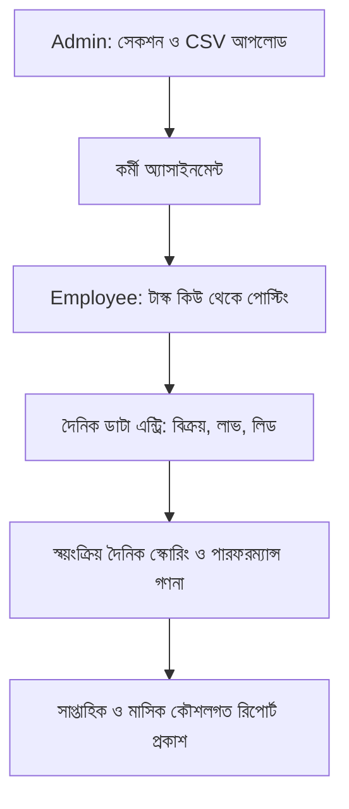

# মার্কেটিং পারফরম্যান্স সিস্টেম (MPS) - পূর্ণাঙ্গ ব্যবহারকারী নির্দেশিকা (User Manual)

মার্কেটিং পারফরম্যান্স সিস্টেম (Marketing Performance System - MPS) একটি আধুনিক, উচ্চ ক্ষমতাসম্পন্ন ও ফলাফল-ভিত্তিক মার্কেটিং ও বিক্রয় ট্র্যাকিং প্ল্যাটফর্ম। এটি হেড অব মার্কেটিং (Admin) এবং ডিজিটাল মার্কেটার (Employee) উভয়ের দৈনন্দিন কাজ, লক্ষ্যমাত্রা, বিক্রয় পাইপলাইন এবং কৌশলগত অগ্রগতি পরিচালনায় সাহায্য করে।

---

## সূচিপত্র

1. [সিস্টেম পরিচিতি ও মূল ধারণাসমূহ](#১-সিস্টেম-পরিচিতি-ও-মূল-ধারণাসমূহ)
2. [লগইন ও প্রাথমিক অ্যাক্সেস](#২-লগইন-ও-প্রাথমিক-অ্যাক্সেস)
3. [অংশ ১: হেড অব মার্কেটিং (Admin) গাইডলাইন](#অংশ-১-হেড-অব-মার্কেটিং-admin-গাইডলাইন)
   - [১.১ সেকশন তৈরি ও ফেসবুক গ্রুপ লিঙ্ক CSV আপলোড](#১১-সেকশন-তৈরি-ও-ফেসবুক-গ্রুপ-লিঙ্ক-csv-আপলোড)
   - [১.২ কর্মী ব্যবস্থাপনা ও সেকশন অ্যাসাইনমেন্ট](#১২-কর্মী-ব্যবস্থাপনা-ও-সেকশন-অ্যাসাইনমেন্ট)
   - [১.৩ টার্গেট ও মার্কেটিং বাজেট নির্ধারণ (ওভারল্যাপ সতর্কতা)](#১৩-টার্গেট-ও-মার্কেটিং-বাজেট-নির্ধারণ-ওভারল্যাপ-সতর্কতা)
   - [১.৪ দৈনিক, সাপ্তাহিক ও মাসিক রিপোর্ট বিশ্লেষণ এবং এক্সপোর্ট (PDF / Excel)](#১৪-দৈনিক-সাপ্তাহিক-ও-মাসিক-রিপোর্ট-বিশ্লেষণ-এবং-এক্সপোর্ট-pdf--excel)
   - [১.৫ সাপ্তাহিক রিপোর্টের ৫টি কৌশলগত প্রশ্নের উত্তর প্রদান ও প্রকাশনা](#১৫-সাপ্তাহিক-রিপোর্টের-৫টি-কৌশলগত-প্রশ্নের-উত্তর-প্রদান-ও-প্রকাশনা)
   - [১.৬ ৯০ দিনের কর্মপরিকল্পনা পরিচালনা ও মাইলস্টোন রিভিউ](#১৬-৯০-দিনের-কর্মপরিকল্পনা-পরিচালনা-ও-মাইলস্টোন-রিভিউ)
   - [১.৭ স্কোরিং সেটিংস ও সিস্টেম সেটিংস কনফিগারেশন](#১৭-স্কোরিং-সেটিংস-ও-সিস্টেম-সেটিংস-কনফিগারেশন)
   - [১.৮ অডিট ট্রেইল পর্যবেক্ষণ](#১৮-অডিট-ট্রেইল-পর্যবেক্ষণ)
4. [অংশ ২: ডিজিটাল মার্কেটার (Employee) গাইডলাইন](#অংশ-২-ডিজিটাল-মার্কেটার-employee-গাইডলাইন)
   - [২.১ আমার কাজ (Task Queue) - লিঙ্ক ওপেন, সম্পন্ন ও আনডু](#২১-আমার-কাজ-task-queue---লিঙ্ক-ওপেন-সম্পন্ন-ও-আনডু)
   - [২.২ দৈনিক পারফরম্যান্স এন্ট্রি (লক উইন্ডো নিয়মাবলী)](#২২-দৈনিক-পারফরম্যান্স-এন্ট্রি-লক-উইন্ডো-নিয়মাবলী)
   - [২.৩ লিড পাইপলাইন - নতুন লিড যোগ, স্ট্যাটাস পরিবর্তন ও আনফিনিশড অর্ডার ফলোআপ](#২৩-লিড-পাইপলাইন---নতুন-লিড-যোগ-স্ট্যাটাস-পরিবর্তন-ও-আনফিনিশড-অর্ডার-ফলোআপ)
   - [২.৪ পারফরম্যান্স ড্যাশবোর্ড ও স্কোর টেবিল বিশ্লেষণ](#২৪-পারফরম্যান্স-ড্যাশবোর্ড-ও-স্কোর-টেবিল-বিশ্লেষণ)
   - [২.৫ লিডারবোর্ড ও পয়েন্ট ব্যবধান পর্যবেক্ষণ](#২৫-লিডারবোর্ড-ও-পয়েন্ট-ব্যবধান-পর্যবেক্ষণ)
   - [২.৬ দৈনিক রিপোর্ট ভিউ ও ডাউনলোড](#২৬-দৈনিক-রিপোর্ট-ভিউ-ও-ডাউনলোড)
5. [প্রায়শই জিজ্ঞাসিত প্রশ্নাবলী (FAQ) ও ট্রাবলশুটিং](#৫-প্রায়শই-জিজ্ঞাসিত-প্রশ্নাবলী-faq-ও-ট্রাবলশুটিং)

---

## ১. সিস্টেম পরিচিতি ও মূল ধারণাসমূহ

মার্কেটিং পারফরম্যান্স সিস্টেমের কার্যপদ্ধতি ৫টি মূল স্তম্ভের ওপর প্রতিষ্ঠিত:
1. **সুনির্দিষ্ট গ্রুপ সেগমেন্টেশন**: পণ্য ও লক্ষ্যভেদে ফেসবুক গ্রুপগুলোকে বিভিন্ন সেকশনে ভাগ করা।
2. **দৈনিক ধারাবাহিক পোস্টিং ও টাস্ক কিউ**: কর্মীদের প্রতিদিন সুনির্দিষ্ট গ্রুপে পোস্ট করার তালিকা প্রদান এবং এক ক্লিকে টাস্ক ট্র্যাকিং।
3. **কঠোর এন্ট্রি উইন্ডো ও ডাটা সত্যতা**: দৈনিক বিক্রয়, লাভ, লিড ও অর্ডার হিসাব একই দিন বা অনুমোদিত উইন্ডোর মধ্যে জমা দেওয়া।
4. **৫ মাত্রিক পারফরম্যান্স স্কোরিং**: বিক্রয় ও লাভ (৩০%), কন্টেন্ট/পোস্ট (২০%), নতুন বায়ার/B2B (২০%), রিটেনশন (১৫%), এবং ইনবক্স ফলোআপ (১৫%)।
5. **কৌশলগত সাপ্তাহিক ও ৯০ দিনের লক্ষ্যমাত্রা**: প্রতি সপ্তাহে ৫টি নির্দিষ্ট প্রশ্নের ভিত্তিতে বিশ্লেষণ এবং ৩ পর্যায়ের ৯০ দিনের পরিকল্পনা বাস্তবায়ন।



---

## ২. লগইন ও প্রাথমিক অ্যাক্সেস

### লগইন প্রক্রিয়া
1. ব্রাউজারে `http://localhost:3000/login` অথবা আপনার প্রতিষ্ঠানের নির্ধারিত ডোমেইনে প্রবেশ করুন।
2. আপনার নিবন্ধিত **অফিসিয়াল ইমেইল** এবং **পাসওয়ার্ড** প্রদান করুন।
3. **"লগইন করুন"** বাটনে ক্লিক করুন।
4. সফল লগইনের পর:
   - **এডমিন ইউজার**: সরাসরি `/admin/dashboard` পেজে স্থানান্তরিত হবেন।
   - **মার্কেটার ইউজার**: সরাসরি `/employee/my-work` (আমার কাজ) পেজে স্থানান্তরিত হবেন।

```
+-------------------------------------------------------------+
|                মার্কেটিং পারফরম্যান্স সিস্টেম              |
|                        সাইন ইন করুন                         |
+-------------------------------------------------------------+
| ইমেইল ঠিকানা : [ employee@company.com                      ] |
| পাসওয়ার্ড   : [ ****************                         ] |
|                                                             |
|                       [ লগইন করুন ]                         |
|                                                             |
| * নোট: পরপর ৫ বার ভুল পাসওয়ার্ড দিলে অ্যাকাউন্ট ১ মিনিট লক থাকবে। |
+-------------------------------------------------------------+
```

> [!CAUTION]
> **নিরাপত্তা নীতি**: পরপর ৫ বার ভুল পাসওয়ার্ড প্রদান করলে আপনার আইপি থেকে পরবর্তী ৬০ সেকেন্ডের জন্য লগইন চেষ্টা ব্লক হয়ে যাবে।

---

# অংশ ১: হেড অব মার্কেটিং (Admin) গাইডলাইন

অ্যাডমিন প্যানেলে হেড অব মার্কেটিং পুরো সিস্টেমের নিয়ন্ত্রণ, কর্মী পর্যবেক্ষণ, লক্ষ্যমাত্রা নির্ধারণ এবং স্ট্র্যাটেজিক রিপোর্ট পরিচালনা করবেন।

---

### ১.১ সেকশন তৈরি ও ফেসবুক গ্রুপ লিঙ্ক CSV আপলোড

মার্কেটিংয়ের মূল ভিত্তি হলো সঠিক অডিয়েন্স বা গ্রুপে তথ্য পৌঁছানো।

#### ১. নতুন সেকশন তৈরি
1. বাম পাশের নেভিগেশন মেনু থেকে **"সেকশন ও গ্রুপ" (Sections)** এ ক্লিক করুন (`/admin/sections`)।
2. উপরে ডানদিকের **"+ নতুন সেকশন তৈরি করুন"** বাটনে ক্লিক করুন।
3. মডালে তথ্য পূরণ করুন:
   - **সেকশনের নাম**: যেমন - `"মাশরুম চাষি ও খামারি ফোরাম"`।
   - **বিবরণ**: সেকশনের উদ্দেশ্য বা লক্ষ্যভিত্তিক গ্রুপ সমূহের বর্ণনা।
   - **স্ট্যাটাস**: "সক্রিয়" (Active) রাখুন।
4. **"সংরক্ষণ করুন"** এ ক্লিক করুন।

#### ২. CSV ফাইলের মাধ্যমে শত শত লিঙ্ক এক ক্লিকে আপলোড
1. সংশ্লিষ্ট সেকশন কার্ডের উপর ক্লিক করে বিস্তারিত পাতায় যান।
2. **"CSV আপলোড করুন"** বাটনে ক্লিক করুন (`/admin/sections/[id]/upload`)।
3. আপনার তৈরি করা `.csv` ফাইল ড্রপ বা সিলেক্ট করুন।
   - **CSV ফরম্যাট নিয়ম**: ফাইলে অবশ্যই `url` হেডার থাকতে হবে এবং ঐচ্ছিক `title` কলাম থাকতে পারে।
   ```csv
   url,title
   https://facebook.com/groups/mushroomgrowersbd,Mushroom Farmers Bangladesh
   https://facebook.com/groups/dhakaagrobusiness,Dhaka Agro Business
   ```
4. **প্রিভিউ (Preview) যাচাই**:
   - সিস্টেম স্বয়ংক্রিয়ভাবে লিঙ্কগুলো থেকে অপ্রয়োজনীয় ট্র্যাকিং প্যারামিটার মুছে দেবে।
   - ডাটাবেজে ইতিমধ্যে লিঙ্কটি থাকলে তা `DUPLICATE` হিসেবে চিহ্নিত করে বাদ দেবে।
5. প্রিভিউতে বৈধ সংখ্যা দেখে **"নিশ্চিত করুন এবং আপলোড সম্পন্ন করুন"** এ ক্লিক করুন।
6. আপলোড হিস্ট্রি দেখতে মেনুর **"CSV হিস্ট্রি"** (`/admin/csv/history`) পাতায় যে কোনো সময় ব্যাচ রিপোর্ট দেখা যাবে।

---

### ১.২ কর্মী ব্যবস্থাপনা ও সেকশন অ্যাসাইনমেন্ট

প্রতিটি ডিজিটাল মার্কেটারকে তাদের দক্ষতানুসারে নির্দিষ্ট সেকশনে যুক্ত করতে হবে।

#### ১. নতুন কর্মী যুক্ত করা
1. মেনু থেকে **"কর্মী ব্যবস্থাপনা" (Employees)** পাতায় যান (`/admin/employees`)।
2. **"+ নতুন কর্মী যোগ করুন"** বাটনে ক্লিক করুন।
3. প্রয়োজনীয় তথ্য পূরণ করুন:
   - **নাম**: কর্মীর পূর্ণ নাম।
   - **অফিসিয়াল ইমেইল**: অনন্য ইমেইল আইডি।
   - **১১ ডিজিটের মোবাইল নম্বর**: যেমন `01711223344`।
   - **প্রাথমিক পাসওয়ার্ড**: ন্যূনতম ৬ অক্ষরের সুরক্ষিত পাসওয়ার্ড।
   - **সেকশন নির্বাচন**: কর্মী যে সেকশনের গ্রুপগুলোতে পোস্ট করবেন তা টিক দিন।
4. **"কর্মী তৈরি করুন"** বাটনে চাপ দিন।

```
+-------------------------------------------------------------+
| [অ্যাডমিন] কর্মী ব্যবস্থাপনা: সেকশন অ্যাসাইনমেন্ট           |
+-------------------------------------------------------------+
| কর্মী: রাকিব হাসান (rakib@company.com)                       |
| অ্যাসাইনকৃত সেকশনসমূহ:                                      |
|  [X] ১. মাশরুম চাষি ও খামারি ফোরাম (৪৫ লিঙ্ক)               |
|  [X] ২. রেস্তোরাঁ ও পাইকারি ক্রেতা গ্রুপ (৬০ লিঙ্ক)          |
|  [ ] ৩. গৃহিণী ও কিচেন গার্ডেনার গ্রুপ                     |
|                                                             |
|                    [ অ্যাসাইনমেন্ট আপডেট করুন ]              |
+-------------------------------------------------------------+
```

> [!NOTE]
> কোনো কর্মী ছুটি কাটালে বা দায়িত্ব পরিবর্তন হলে কর্মীর প্রোফাইলে গিয়ে "অ্যাসাইনমেন্ট পরিবর্তন" বাটনে ক্লিক করে মুহূর্তেই সেকশন রদবদল করা যায়।

---

### ১.৩ টার্গেট ও মার্কেটিং বাজেট নির্ধারণ (ওভারল্যাপ সতর্কতা)

সঠিক পারফরম্যান্স স্কোরিংয়ের জন্য প্রতি মাসের শুরুতে প্রতিটি সেকশনের জন্য লক্ষ্যমাত্রা (Target) ও বাজেট ঠিক করা আবশ্যক।

#### ১. টার্গেট সেট করা (`/admin/targets`)
1. **"টার্গেট নির্ধারণ"** মেনুতে ক্লিক করুন।
2. **"+ নতুন টার্গেট যোগ করুন"** চাপুন।
3. ফিল্ডসমূহ পূরণ করুন:
   - **সেকশন**: টার্গেট যে সেকশনের জন্য প্রযোজ্য।
   - **মেট্রিক টাইপ**: যেমন - দৈনিক পোস্ট সংখ্যা (`POSTS_DONE`), বিক্রয় টাকা (`SALES_AMOUNT`), মুনাফা (`PROFIT_AMOUNT`), নতুন বায়ার (`NEW_CLIENTS`), ইত্যাদি।
   - **টার্গেট ভ্যালু**: সংখ্যামান (যেমন: মাসে মোট ৬০০ পোস্ট বা ৩,০০,০০০ টাকা বিক্রয়)।
   - **সময়সীমা (Period)**: `মাসিক (MONTHLY)` অথবা `কাস্টম তারিখ`।
4. **ওভারল্যাপ সতর্কতা (Overlap Warning)**:
   - সিস্টেম স্বয়ংক্রিয়ভাবে পরীক্ষা করে দেখে ওই সেকশনে একই মেট্রিকের জন্য নির্ধারিত তারিখের সাথে বিদ্যমান কোনো টার্গেটের তারিখের সংঘাত (Overlap) হচ্ছে কি না।
   - সংঘাত ঘটলে সিস্টেম লাল রঙের অ্যালার্ট দিয়ে আটকাবে এবং পুরনো টার্গেট এডিট করতে নির্দেশ দেবে।

#### ২. বাল্ক কপি (Bulk Copy) সুবিধা
যদি একই টার্গেট একাধিক সেকশনের জন্য প্রযোজ্য হয়, তবে **"টার্গেট অনুলিপি করুন" (Bulk Copy)** বাটনে ক্লিক করে একটি মূল সেকশনের সকল টার্গেট একসাথে অন্য সকল সেকশনে কপি করে দেওয়া যায়।

#### ৩. মার্কেটিং বাজেট নির্ধারণ (`/admin/campaigns` বা `/admin/targets`)
- **মাসিক মোট বাজেট**: সারা মাসের সামগ্রিক মার্কেটিং বাজেট নির্ধারণ করুন।
- **ক্যাম্পেইন বাজেট**: ফেসবুক অ্যাড বা বিশেষ প্রমোশনের জন্য নির্ধারিত বাজেট ও চ্যানেলের তথ্য যুক্ত করুন।

---

### ১.৪ দৈনিক, সাপ্তাহিক ও মাসিক রিপোর্ট বিশ্লেষণ এবং এক্সপোর্ট (PDF / Excel)

এডমিন প্যানেলে রিপোর্ট সেকশনটি কোম্পানির অর্থনৈতিক ও টিম পারফরম্যান্সের প্রধান দর্পণ।

```
+--------------------------------------------------------------------------+
|                       দৈনিক পারফরম্যান্স সামারি (২৫ অক্টোবর)               |
+--------------------------------------------------------------------------+
| মোট বিক্রয়: ৳ ৪৮,৫০০  | মোট লাভ: ৳ ১৪,২০০  | গ্রুপ পোস্ট: ৬৫ টি          |
| মোট লিড: ১২ টি        | B2B অর্ডার: ৬ টি   | গড় স্কোর: ৯৪.২% (পাস)      |
+--------------------------------------------------------------------------+
| কর্মীর নাম     | অ্যাসাইন সেকশন | বিক্রয়   | পোস্ট | স্কোর   | স্ট্যাটাস    |
|----------------|----------------|----------|-------|---------|-------------|
| রাকিব হাসান    | মাশরুম খামারি  | ৳ ১২,৫০০ | ২৫    | ৯৬.৫%   | [পাস (সবুজ)]|
| তানভীর আহমেদ   | রেস্তোরাঁ গ্রুপ| ৳ ১৮,০০০ | ২০    | ৯১.০%   | [পাস (সবুজ)]|
+--------------------------------------------------------------------------+
|  [ Excel এক্সপোর্ট (.xlsx) ]         [ PDF প্রিন্ট ডাউনলোড ]            |
+--------------------------------------------------------------------------+
```

1. **দৈনিক রিপোর্ট (`/admin/reports/daily`)**:
   - যেকোনো তারিখ সিলেক্ট করে ওই দিনের সার্বিক ফলাফল এবং কর্মীভিত্তিক স্কোর দেখা যায়।
   - কর্মীর স্কোর ৮০% এর নিচে নামলে লাল রঙের "ফেইলিং" ব্যাজ প্রদর্শিত হয়।
   - উপরে ডানদিকের **"এক্সপোর্ট Excel"** বাটনে চাপ দিলে মুহূর্তে সম্পূর্ণ ডাটা শিট ডাউনলোড হবে।
2. **মাসিক এক্সিকিউটিভ রিপোর্ট (`/admin/reports/monthly`)**:
   - পুরো মাসের সামগ্রিক অর্জন, মোট খরচ ও নিট মার্জিন শতাংশের হিসাব প্রদর্শন করে।
   - রিপোর্টটি পর্যালোচনার পর হেড অব মার্কেটিং **"ফাইনাল কনফার্ম"** করতে পারবেন।

---

### ১.৫ সাপ্তাহিক রিপোর্টের ৫টি কৌশলগত প্রশ্নের উত্তর প্রদান ও প্রকাশনা

প্রতি রবিবার সকাল ৯:০০ টায় সিস্টেম বিগত সপ্তাহের (রবিবার থেকে শনিবার) ডাটা দিয়ে একটি ড্রাফট রিপোর্ট তৈরি করে (`/admin/reports/weekly`)।

#### স্বয়ংক্রিয় ডাটা এবং ৫টি প্রশ্নের বিশ্লেষণ কাঠামো:
1. **প্রশ্ন ১ (স্বয়ংক্রিয় ডাটা সহ): কোন কোন পণ্যে সর্বোচ্চ বিক্রয় ও প্রবৃদ্ধি হয়েছে?**
   - সিস্টেম সেরা বিক্রিত পণ্যের তালিকা ও রাজস্ব প্রদর্শন করে। হেড অব মার্কেটিং ব্যাখ্যা লিখবেন।
2. **প্রশ্ন ২ (স্বয়ংক্রিয় ডাটা সহ): কোন চ্যানেল বা ক্যাম্পেইনে মার্কেটিং বাজেট সবচেয়ে কার্যকরী ছিল?**
   - প্রতি ক্যাম্পেইনের খরচ বনাম বিক্রয় (ROAS) প্রদর্শিত হয়।
3. **প্রশ্ন ৩ (স্বয়ংক্রিয় ডাটা সহ): লিড ফানেলের কনভার্সন রেট কেমন ছিল এবং কোথায় ড্রপ-অফ ঘটেছে?**
   - নতুন লিড বনাম অর্ডারের শতকরা হার দেখা যায়।
4. **প্রশ্ন ৪: চলতি সপ্তাহের প্রধান চ্যালেঞ্জ ও প্রতিবন্ধকতা কী কী ছিল?**
   - এডমিন মাঠপর্যায়ের সীমাবদ্ধতা ও লজিস্টিকস সমস্যা লিখবেন।
5. **প্রশ্ন ৫: আগামী সপ্তাহের শীর্ষ ৩টি অগ্রাধিকার কর্মপরিকল্পনা কী?**
   - পরবর্তী ৭ দিনের ৩টি সুনির্দিষ্ট অ্যাকশন প্ল্যান লিখুন।
6. উত্তর লেখা সম্পন্ন হলে **"পাবলিশ করুন (Publish Report)"** এ ক্লিক করুন। পাবলিশ করা রিপোর্ট সকল টিম মেম্বার ডাউনলোড ও পাঠ করতে পারবে।

---

### ১.৬ ৯০ দিনের কর্মপরিকল্পনা পরিচালনা ও মাইলস্টোন রিভিউ

কোম্পানির দীর্ঘমেয়াদী লক্ষ্যমাত্রা বাস্তবায়নের জন্য ৯০ দিনের প্ল্যানার (`/admin/plan`) অত্যন্ত কার্যকর।

- **পর্যায় ১ (দিন ১–৩০)**: ফাউন্ডেশন, গ্রুপ ডাটাবেজ তৈরি ও প্রাথমিক ক্লায়েন্ট পাইপলাইন।
- **পর্যায় ২ (দিন ৩১–৬০)**: স্কেলিং, B2B ডিলারশিপ নেটওয়ার্ক ও বুস্টিং অটোমেশন।
- **পর্যায় ৩ (দিন ৬১–৯০)**: অপটিমাইজেশন, ব্র্যান্ড কর্তৃত্ব ও পুনরাবৃত্তি বিক্রয় বৃদ্ধি।

#### কার্যপদ্ধতি:
1. **টাস্ক যুক্ত করা**: প্রতিটি ফেজের ভেতরে "+ নতুন টাস্ক যোগ করুন" বাটনে ক্লিক করে দায়িত্বপ্রাপ্ত কর্মী ও সমাপ্তির তারিখ (Due Date) নির্ধারণ করুন।
2. **মাইলস্টোন মূল্যায়ন**: প্রতি ফেজের শেষে নির্ধারিত মাইলস্টোনে ক্লিক করে তার বর্তমান অগ্রগতি (`MET` - অর্জিত, `PARTIAL` - আংশিক, `MISSED` - মিস হয়েছে) সিলেক্ট করুন এবং কারণ লিপিবদ্ধ করুন।

---

### ১.৭ স্কোরিং সেটিংস ও সিস্টেম সেটিংস কনফিগারেশন

অ্যাডমিন সেটিংস পেজে (`/admin/settings`) পুরো প্রতিষ্ঠানের মূল প্যারামিটারগুলো নির্ধারণ করা হয়:
- **৫টি সেকশনের ওজন (Weights)**:
  - বিক্রয় ও লাভ ওজন: ৩০%
  - কন্টেন্ট ও পোস্ট ওজন: ২০%
  - নতুন ক্লায়েন্ট ও B2B অর্ডার: ২০%
  - ক্লায়েন্ট রিটেনশন: ১৫%
  - ইনবক্স ও ফলোআপ: ১৫%
  - *(নিয়ম: এই ৫টি ওজনের যোগফল অবশ্যই ঠিক ১০০% হতে হবে)*।
- **অ্যাচিভমেন্ট ক্যাপ (Achievement Cap)**: ডিফল্ট ১.০ (১০০%)। অর্থাৎ টার্গেটের অতিরিক্ত কাজ করলেও ওজনের বেশি অতিরিক্ত নম্বর যোগ হয়ে অন্যদের বঞ্চিত করবে না।
- **ফেইলিং থ্রেশহোল্ড (Failing Threshold)**: ডিফল্ট ০.৮০ (৮০%)। ৮০% এর নিচে স্কোর পেলে তা অসন্তোষজনক বিবেচিত হবে।
- **আনডু সুবিধা চালু/বন্ধ**: কর্মীরা কাজ ভুলবশত কমপ্লিট করলে তা আনডু করতে পারবে কি না।
- **এডিট উইন্ডো (Edit Window Days)**: কর্মীরা পেছনের কতদিনের ডাটা এন্ট্রি করতে পারবে (ডিফল্ট: ১ দিন)।

---

### ১.৮ অডিট ট্রেইল পর্যবেক্ষণ

সিস্টেমের ডাটা নিরাপত্তা ও নির্ভরযোগ্যতার জন্য প্রতিটি সংবেদনশীল কাজ অডিট লগে সংরক্ষিত হয় (`/admin/audit`):
- কে কখন লগইন করেছে, পাসওয়ার্ড রিসেট করেছে, টাস্ক সম্পন্ন বা আনডু করেছে, ডাটাবেজ এডিট করেছে বা রিপোর্ট পাবলিশ করেছে - তার সম্পূর্ণ টাইমস্ট্যাম্প, আইপি ও পে-লোড ফিল্টার করে দেখা যায়।

---

# অংশ ২: ডিজিটাল মার্কেটার (Employee) গাইডলাইন

ডিজিটাল মার্কেটারদের জন্য সিস্টেমটি অত্যন্ত সহজ ও মোবাইল-ফ্রেন্ডলি ইন্টারফেসে তৈরি।

---

### ২.১ আমার কাজ (Task Queue) - লিঙ্ক ওপেন, সম্পন্ন ও আনডু

লগইন করার সাথে সাথেই কর্মীর সামনে আসে তার আজকের কাজের তালিকা (`/employee/my-work`)।

```
+-------------------------------------------------------------+
|                     আমার কাজ (Task Queue)                   |
| আজকের অগ্রগতি: [==========          ] ৫০% (২৫/৫০ সম্পন্ন)    |
+-------------------------------------------------------------+
| সেকশন নির্বাচন: [ মাশরুম চাষি ও খামারি ফোরাম (৪৫)         v ]|
|                                                             |
| ১. Mushroom Farmers Bangladesh                              |
|    URL: https://facebook.com/groups/mushroomgrowersbd       |
|    [ ওপেন করুন (Open) ]     [ সম্পন্ন করেছি (Mark Done) ]   |
|                                                             |
| ২. Dhaka Agro Business Network                              |
|    URL: https://facebook.com/groups/dhakaagrobusiness       |
|    [ ওপেন করুন (Open) ]     [ সম্পন্ন করেছি (Mark Done) ]   |
+-------------------------------------------------------------+
| আজকে সম্পন্নকৃত লিঙ্কসমূহ:                                   |
| - Commercial Agro BD (সকাল ১০:১৫)          [ আনডু (Undo) ]  |
+-------------------------------------------------------------+
```

#### ধাপসমূহ:
1. **গ্রুপ লিঙ্ক ওপেন**: টাস্ক কার্ডের **"ওপেন করুন" (Open)** বাটনে চাপ দিলে নতুন ট্যাবে নির্দিষ্ট ফেসবুক গ্রুপটি খুলে যাবে।
2. **পোস্ট করুন**: গ্রুপের নিয়ম মেনে আপনার নির্ধারিত পণ্যের ছবি/কন্টেন্ট পোস্ট করুন।
3. **সম্পন্ন করুন**: সিস্টেমে ফিরে এসে **"সম্পন্ন করেছি" (Mark Done)** বাটনে ক্লিক করুন। সাথে সাথে কার্ডটি সবুজ হয়ে নিচের সম্পন্ন তালিকায় চলে যাবে এবং প্রোগ্রেস বার বৃদ্ধি পাবে।
4. **ভুল হলে আনডু (Undo)**: যদি ভুল করে অন্য গ্রুপে পোস্ট করে সম্পন্ন বাটনে ক্লিক করে ফেলেন, তবে নিচের সম্পন্ন তালিকা থেকে সংশ্লিষ্ট লিঙ্কের পাশের **"আনডু" (Undo)** বাটনে চাপ দিলেই লিঙ্কটি পুনরায় আপনার কাজের তালিকায় ফিরে আসবে।

---

### ২.২ দৈনিক পারফরম্যান্স এন্ট্রি (লক উইন্ডো নিয়মাবলী)

দিনের কাজ শেষে বা নির্ধারিত সময়ে কর্মীকে তার দৈনিক বিক্রয় ও পারফরম্যান্স এন্ট্রি জমা দিতে হবে (`/employee/daily-entry`)।

```
+-------------------------------------------------------------+
|               দৈনিক পারফরম্যান্স ডাটা এন্ট্রি               |
| তারিখ: ২৫ অক্টোবর, ২০২৬  [ স্ট্যাটাস: এন্ট্রি খোলা (Open) ]  |
+-------------------------------------------------------------+
| ১. মেট্রিক হিসাব:                                           |
|   - আজকের মোট বিক্রয় (৳): [ 12500                         ] |
|   - আজকের মোট লাভ (৳):    [ 3750                          ] |
|   - নতুন ক্লায়েন্ট সংখ্যা: [ 4                             ] |
|   - B2B অর্ডার সংখ্যা:      [ 2                             ] |
|   - পুরাতন ক্লায়েন্ট রিটেনশন: [ 3                             ] |
|   - মোট ফলোআপ সম্পন্ন:     [ 18                            ] |
|                                                             |
| ২. পণ্যভিত্তিক বিক্রয় বিভাজন:                               |
|   + বাটন মাশরুম (Button Mushroom): [ ২৫ কেজি ] = ৳ ১২,৫০০  |
|                                                             |
| ৩. প্রতিদিনের নোট ও পর্যবেক্ষণ:                              |
|   - প্রধান সমস্যা/চ্যালেঞ্জ: [ কুরিয়ার বিলম্বে পণ্য দেরিতে পৌঁছেছে ]|
|   - আগামীকালের অগ্রাধিকার:    [ নতুন ৫টি রেস্তোরাঁয় ভিজিট করা   ]|
|                                                             |
|                 [ দৈনিক ডাটা সংরক্ষণ করুন ]                 |
+-------------------------------------------------------------+
```

> [!IMPORTANT]
> **লক উইন্ডো নিয়ম (Edit Window Rule)**:
> - দৈনিক এন্ট্রি অবশ্যই আজকের দিন বা সর্বোচ্চ গতকালের মধ্যে জমা দিতে হবে (এডমিন নির্ধারিত উইন্ডো অনুযায়ী)।
> - রাত ১২:০০ টা পার হলে আগের দিনগুলোর এন্ট্রি স্থায়ীভাবে **লক (Locked)** হয়ে যায়। লক হওয়া তারিখে কোনো ডাটা এডিট বা নতুন এন্ট্রি করা সম্ভব নয়।

---

### ২.৩ লিড পাইপলাইন - নতুন লিড যোগ, স্ট্যাটাস পরিবর্তন ও আনফিনিশড অর্ডার ফলোআপ

ফেসবুক গ্রুপ বা প্রচারণার মাধ্যমে আসা সকল কাস্টমারদের পরিচালনা করা হয় লিড পাইপলাইনে (`/employee/leads`)।

#### ১. নতুন লিড যোগ করা
1. **"+ নতুন লিড যোগ করুন"** বাটনে চাপ দিন।
2. কাস্টমারের নাম, সঠিক ১১ ডিজিটের মোবাইল নম্বর (যেমন: `017XXXXXXXX`), ঠিকানা এবং সম্ভাব্য ক্রয়ের পরিমাণ উল্লেখ করুন।
3. **ফোন নম্বর যাচাই**: যদি নম্বরটি আগে থেকেই সিস্টেমে অন্য কোনো কর্মীর আন্ডারে থাকে, সিস্টেম তৎক্ষণাৎ সতর্কবার্তা প্রদর্শন করবে।

#### ২. লিড স্ট্যাটাস পর্যায়সমূহ
- **NEW (নতুন)**: ইনবক্স বা কমেন্ট থেকে নাম ও নম্বর সংগ্রহ করা হয়েছে।
- **CONTACTED (যোগাযোগ সম্পন্ন)**: ফোনে কথা বলা হয়েছে বা পণ্যের মূল্য জানানো হয়েছে।
- **QUALIFIED (আগ্রহী/যোগ্য)**: কাস্টমার পণ্য কিনতে সম্মত এবং স্পেসিফিকেশন পছন্দ করেছেন।
- **ORDERED (অর্ডার কনফার্ম)**: কাস্টমার অর্ডার নিশ্চিত করেছেন এবং চালান তৈরি হয়েছে।
- **LOST (বাতিল)**: কাস্টমার কিনতে অপারগ বা দাম নিয়ে মতবিরোধ।

#### ৩. আনফিনিশড অর্ডার ফলোআপ (Unfinished Orders Alert)
- যদি কোনো লিড **QUALIFIED** অবস্থায় পৌঁছানোর পর টানা **৩ দিন** পার হয়ে যায় কিন্তু কোনো অর্ডার না হয়, তবে সিস্টেম স্বয়ংক্রিয়ভাবে সেটিকে **কমলা/লাল রঙে হাইলাইট** করে দেয়।
- মার্কেটারদের কাজ হলো ফিল্টারে **"আনফিনিশড অর্ডার" (Unfinished)** সিলেক্ট করে আটকে থাকা ক্লায়েন্টদের দ্রুত কল করা এবং ফলোআপ নোট যুক্ত করা।

---

### ২.৪ পারফরম্যান্স ড্যাশবোর্ড ও স্কোর টেবিল বিশ্লেষণ

মার্কেটার নিজের পারফরম্যান্স ড্যাশবোর্ডে (`/employee/performance`) দেখতে পারবেন কোম্পানি তাকে কীভাবে মূল্যায়ন করছে।

#### স্কোর টেবিল কীভাবে কাজ করে?
| মূল্যায়নের ক্ষেত্র | ওজন (Weight) | টার্গেট | অর্জিত | অর্জনের হার | ফাইনাল পয়েন্ট |
|---|---|---|---|---|---|
| বিক্রয় ও লাভ | ৩০% | ৳ ১০,০০০ | ৳ ১২,৫০০ | ১০০% (ক্যাপ্ড) | ৩০.০ |
| গ্রুপ পোস্টিং | ২০% | ২০ টি | ২৫ টি | ১০০% (ক্যাপ্ড) | ২০.০ |
| নতুন ক্লায়েন্ট ও B2B | ২০% | ৫ জন | ৪ জন | ৮০% | ১৬.০ |
| ক্লায়েন্ট রিটেনশন | ১৫% | ৪ জন | ৪ জন | ১০০% | ১৫.০ |
| ইনবক্স ফলোআপ | ১৫% | ২০ টি | ১৮ টি | ৯০% | ১৩.৫ |
| **সর্বমোট স্কোর** | **১০০%** | - | - | - | **৯৪.৫% (পাস)**|

- স্কোর **৮০% বা তার বেশি** হলে ড্যাশবোর্ডে সবুজ রঙের ব্যাজ ও অভিনন্দন বার্তা প্রদর্শিত হয়।
- বিগত ১৪ দিনের স্কোরের ট্রেন্ড চার্ট দেখে মার্কেটার বুঝতে পারবেন তার পারফরম্যান্স ঊর্ধ্বমুখী নাকি নিম্নমুখী।

---

### ২.৫ লিডারবোর্ড ও পয়েন্ট ব্যবধান পর্যবেক্ষণ

- টিমের সকল ডিজিটাল মার্কেটারের মধ্যে স্বাস্থ্যকর প্রতিযোগিতার জন্য লিডারবোর্ড সক্রিয় থাকে।
- লিডারবোর্ডে ১ম, ২য় ও ৩য় স্থানধারীদের বিশেষ ট্রফি আইকন দিয়ে চিহ্নিত করা হয়।
- শীর্ষস্থানধারীর সাথে আপনার পয়েন্টের ব্যবধান কত (যেমন: *"১ম স্থান থেকে মাত্র ২.৫ পয়েন্ট পেছনে"*) তা দেখে নিজের কাজের গতি বৃদ্ধি করা যায়।

---

### ২.৬ দৈনিক রিপোর্ট ভিউ ও ডাউনলোড

- কর্মীরা তাদের নিজস্ব বিগত দিনের রিপোর্টগুলো যেকোনো সময় দেখতে এবং ব্যক্তিগত রেকর্ডের জন্য PDF বা এক্সেলে ডাউনলোড করতে পারবেন।

---

## ৫. প্রায়শই জিজ্ঞাসিত প্রশ্নাবলী (FAQ) ও ট্রাবলশুটিং

### প্র: আমি গত পরশুর ডাটা এন্ট্রি করতে পারছি না কেন?
**উ:** সিস্টেমের ডাটা ইন্টিগ্রিটি বজায় রাখার জন্য ব্যাকডেটেড ডাটা এন্ট্রি ডিফল্টভাবে ১ দিন পর্যন্ত সীমাবদ্ধ থাকে। জরুরি প্রয়োজনে হেড অব মার্কেটিংয়ের সাথে যোগাযোগ করে এডিট উইন্ডো সাময়িক বাড়িয়ে নিতে পারেন।

### প্র: CSV আপলোড করার সময় "Duplicate links found" দেখাচ্ছে কেন?
**উ:** আপনার ফাইলে এমন কিছু লিঙ্ক রয়েছে যা আগে থেকেই ওই সেকশনে বা ডাটাবেজে বিদ্যমান। সিস্টেম স্বয়ংক্রিয়ভাবে ডুপ্লিকেট লিঙ্কগুলো বাদ দিয়ে কেবল নতুন লিঙ্কগুলো যুক্ত করবে, ফলে কোনো সমস্যা নেই।

### প্র: আমার স্কোর ১০০% এর বেশি উঠছে না কেন যখন আমি টার্গেটের চেয়ে দ্বিগুণ বিক্রি করেছি?
**উ:** সিস্টেমে `Achievement Cap` ১.০ (১০০%) সেট করা রয়েছে। এটি নিশ্চিত করে যে কোনো একটি মেট্রিক অতিরিক্ত অর্জিত হলেও কর্মীকে অন্যান্য মেট্রিকগুলোতেও (যেমন কন্টেন্ট বা ফলোআপ) সুষম মনোযোগ দিতে হবে।

---

**প্রস্তুতকারক ও সহায়তা টিম**:  
মার্কেটিং টেকনোলজি ও অ্যানালিটিক্স ডিপার্টমেন্ট  
*সিস্টেম ভার্সন: ১.০.০ | সর্বশেষ আপডেট: অক্টোবর ২০২৬*
